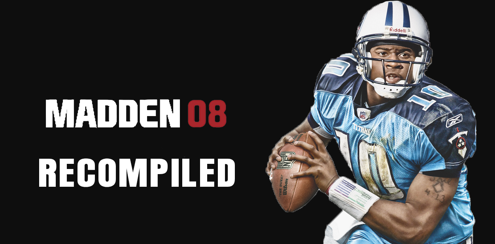

# Madden NFL 08 Recompiled

A native Windows port of EA Sports Madden NFL 08 for the Xbox 360, made with static recompilation via the ReXGlue SDK.

> Unofficial fan project. Not affiliated with or endorsed by Electronic Arts, EA Sports, EA Tiburon, the NFL or the NFL Players Association. All trademarks belong to their owners. This repository contains no game files and no game code. The banner image uses artwork owned by its respective owners, for identification only. You need your own legally obtained copy of the game. Requests for or links to game files will be removed.

## What this is

This repository holds the pieces that make the ReXGlue SDK work with Madden NFL 08: the fix list that lets the recompiler understand the game, a small launcher program, and two small patches to the SDK:

- `patches/codegen_vector_alias.patch`: fixes a bug in the SDK's code generator. Some Xbox 360 vector pack instructions wrote their result while still reading their input, which corrupted video frames, player poses, the field and crowd, and text.
- `patches/texture_mip_layout.patch`: ports fixes from Xenia Canary's texture layout code, so the smaller (mip-mapped) versions of array and volume textures are read from the right place. This fixes the jumbled jersey names and numbers, the names under the players and the helmets.

The game itself is translated on your own computer from your own copy.

## Status

Works:
- Boots, intro videos, menus, Play Now games, the field, crowd, player models, jersey names and numbers, and helmets
- Saving and loading
- Franchise and Superstar mode: starting, playing and saving worked in short tests
- Watching replays during a game
- Music and sound
- Keyboard input (and an XInput game controller)
- The game's own icon on the window, taskbar and shortcut

Known issues:
- Tiny white lines can flicker in a few places before the snap. They do not affect play.
- The first time a new scene appears, the game can hitch for a moment while graphics shaders are built. It is smooth the next time. Short stutters can also happen when a game loads.
- Jersey numbers with a single digit (for example a quarterback wearing 8) show an extra 0, as in "80". The Xenia Canary emulator reports the same corruption for single-digit numbers.
- The countdown beeps during the 40-yard dash in Superstar practice drills do not play.
- On the first launch on a PC (or the first launch on a new graphics chip), the grass can look brown and the game can lag while shaders are built. Restart the game and it is fine. This happened on both test PCs, and the Xenia emulator reports the same.
- On low-end PCs the game can run too slowly to play (see "Graphics card and processor" below).
- Online features do not work, including the NFL news and sports news screens, which need EA's servers.

## Tested on

- Laptop: AMD Ryzen 7 7735HS, NVIDIA RTX 4060 Laptop GPU, 32 GB RAM, Windows 10 Home. Plays smoothly.
- Desktop: AMD Ryzen 3 3200G (4 cores, 4 threads), Radeon RX 550 plus the Vega 8 graphics built into the processor, about 14 GB RAM, Windows 10 Home. The setup program installed Git and built everything in about 28 minutes. The RX 550 does not support a graphics feature the game needs, so the screen stays black on it. On the Vega 8 the menus and loading work, but games run far too slowly to play.

## What you need

- Windows 10 or 11, 64-bit (only Windows 10 has been tested), and a graphics card that supports Direct3D 12 with rasterizer-ordered views (see "Graphics card and processor" below)
- About 10 GB of free disk space for the build, plus room for your extracted game files
- An internet connection for the first setup (it downloads the ReXGlue SDK and its libraries)
- Your own copy of Madden NFL 08 for Xbox 360 (Title ID 4541081D), extracted so that `default.xex` and the game's other files sit in one folder. Extract your game's disc image with a tool such as Xbox Image Browser. The supported `default.xex` is 20,529,152 bytes with the SHA-256 hash `962EA344FB966E1BE1C94667D4213A309A69A821AE3BEC0CB2FCA4166ECC6627`. Other releases are not supported, and setup warns you if yours is different.
- Visual Studio 2022 Community (free), with these parts ticked in the Visual Studio Installer: "Desktop development with C++", "C++ Clang Compiler for Windows" and "C++ CMake tools for Windows". The Build Tools edition and other Visual Studio versions have not been tested.
- Git for Windows (the setup program under "Easy install" can install Git and Visual Studio for you if they are missing)

### Graphics card and processor

The game needs a graphics card that supports Direct3D 12 "rasterizer-ordered views". The NVIDIA RTX 4060 Laptop GPU and the AMD Radeon Vega 8 (built into some Ryzen processors) both report "yes". The AMD Radeon RX 550 reports "no", and the other RX 400 and 500 series cards are the same generation, so expect the same from them. With such a card the game starts and you can hear it, but the screen stays black.

To check your card, open `dist\Launch Madden NFL 08.bat` in Notepad, change `--log_level=error` to `--log_level=info`, run it once, then open the newest file in `dist\logs`. Near the top, look for "Rasterizer-ordered views: yes" or "no", and for the name of the graphics chip the game picked ("DXGI adapter").

If your PC has a second graphics chip that supports it (for example the one built into the processor), add `--d3d12_adapter=1` to the end of the last line of the launcher, or to the end of the Target box of the desktop shortcut. If that picks the wrong chip, try 0 or 2. Running setup again rewrites the launcher and shortcut, so add the option again afterwards.

The game also needs a fast processor. On a desktop with a 4-core, 4-thread Ryzen 3 3200G and its built-in Vega 8 graphics, the menus and loading worked, but games ran far too slowly to play. It is not known whether the processor, the built-in graphics or both were the limit. The log warns "Too few processor cores" on processors like that.

## Setup

This is an early version, tested so far on two PCs (see "Tested on" above). Reports from other PCs, good or bad, are welcome: please [open an issue](https://github.com/anishchandra24/MaddenNFL08-Recompiled/issues/new/choose).

### Easy install (recommended)

1. Download `MaddenNFL08-Recompiled-Setup.exe` from the [Releases page](https://github.com/anishchandra24/MaddenNFL08-Recompiled/releases).
2. Run it. Windows may show "Windows protected your PC" because the program is not code-signed. Click "More info", then "Run anyway". You can check your download against the SHA-256 fingerprint in the release notes.
3. Click "Browse..." next to "Your game folder" and choose the folder that contains `default.xex`. Keep the suggested install folder or choose another short path, then click "Install".
4. Wait. If Git or Visual Studio 2022 Community are missing, the program installs them with Windows' package installer (Windows asks for permission), then downloads the project and builds the game. Allow 15 to 30 minutes, plus the downloads and any Visual Studio install.
5. When it says it is done, click "Play", or use the "Madden NFL 08 Recompiled" shortcut on your desktop.

To remove it, use Settings, Apps, "Madden NFL 08 Recompiled" (or the "Uninstall" button in the setup program). Uninstalling never touches your game files, and it asks before deleting your saves.

Automatic installation of Visual Studio has not been tested on a PC that does not have it. If you try it, please open an issue and tell me how it went, whether it worked or not. If it fails, install the tools by hand (see "What you need") and run the setup program again.

### Manual install

If you prefer to do it by hand, or the setup program does not work for you:

1. Install the tools listed above.
2. Download this project into a short folder path (long paths can break the build). Open a command prompt and run:

        git clone https://github.com/anishchandra24/MaddenNFL08-Recompiled.git C:\Madden08

3. Open the `C:\Madden08` folder and double-click `setup.bat`. When it asks, type the path to your extracted game folder (the folder that contains `default.xex`) and press Enter.
4. Wait. Setup checks your tools and game files, downloads the ReXGlue SDK at the exact version this project uses, applies the three patches, builds the SDK, generates the game's code from your `default.xex`, builds the game, and creates a desktop shortcut. Allow 15 to 30 minutes, including the downloads. Slower PCs or connections will take longer.
5. Start the game from the "Madden NFL 08 Recompiled" shortcut on your desktop, or run `dist\Launch Madden NFL 08.bat`.

Notes:

- If Windows Firewall asks about `madden08.exe`, you can click Cancel. The game does not need network access to run (online features are not supported).
- If setup stops, it prints what went wrong. Fix the problem and run `setup.bat` again; finished steps are skipped. Detailed logs are in `.local\logs`.
- Options: run `setup.bat -NoShortcut` for no desktop shortcut, `setup.bat -SkipIcon` to skip the game's icon, or `setup.bat -Rebuild` to rebuild the SDK from scratch.
- The game's icon is made from your own copy of the game during setup. For that, the game window opens for a few seconds and closes by itself. This is expected. The icon is not part of this repository.
- Setup creates a folder named `assets` inside the project. It is a link to your game folder, not a copy. Before deleting the project folder by hand, open a command prompt in it and run `rmdir assets`, so your game files are not touched. The uninstaller does this for you.
- The game starts with `--render_target_path_d3d12=rov`, which the launcher and shortcut add for you. Without it the menus are black.
- Saves, settings and achievements are stored in `Documents\madden08`, not in the project folder. Back this folder up before trying new builds.

## Reporting problems and test results

Found a bug, or hit a problem during setup? Please [open an issue](https://github.com/anishchandra24/MaddenNFL08-Recompiled/issues/new/choose). Test reports are just as welcome as bug reports, including "it worked": this project has only been tested on two PCs, so every report helps. Useful things to include are your Windows version, your CPU, graphics card and RAM, whether setup finished, and the last lines of the logs. The setup program's log is `%TEMP%\Madden08-Setup.log`, and the setup steps log to `.local\logs` inside the install folder.

Please do not post or link game files. Requests for game files will be removed.

## Controls (keyboard)

Keyboard mode must be on (`mnk_mode`); the launcher and shortcut turn it on. Defaults:
- Start: Enter or X
- A: Space or ;
- B: Backspace or '
- X: L
- Y: P
- Left stick: W A S D
- Right stick: arrow keys
- Triggers: Q / E (or I / O)
- Shoulders: 1 and 3
- Back: Tab or Z
- F3 shows performance info, F4 shows settings

An XInput game controller also works.

## Developer tools

The `tools/` folder has Python helper scripts used while building the fix list in `madden08_manifest.toml`: things like finding gaps and overlapping functions in the recompiled code, scanning for jump tables and code pointers, comparing generated output, and counting vector (VMX) instructions. You do not need them to install or play. They are included for anyone who wants to see how the fix list was made, or who wants to port another game.

## How this was made

This project was developed in a chat conversation with Claude, an AI assistant by Anthropic. Claude wrote the diagnostic commands, configuration fixes, code and patches. Claude had no access to the developer's computer: everything it wrote was copied in by hand, run and tested by me, the project owner (anishchandra24), who also reported what happened, supplied knowledge of the original game, and made all decisions. Claude Code was not used. It has been tested by me on two PCs (see "Tested on" above) and has not been reviewed by anyone else.

## Credits

- anishchandra24: project, fixes and testing
- The ReXGlue SDK by Tom Clay and contributors
- The Xenia project (Ben Vanik and contributors), whose work the SDK's graphics code builds on
- The Xenia Canary project, and goldislead in particular, whose texture layout fixes (pull request #1243) the texture patch is based on
- Claude (Anthropic): AI assistant used to write code, patches and diagnostics (see "How this was made")

## License

The files in this repository are released under the GNU General Public License v3.0 (see LICENSE). The license covers only what this project is entitled to license. It grants no rights to the game's files, or to anything generated from them on your own computer. The banner image shows artwork and logos owned by their respective owners and is not covered by this license. The patches modify code from the ReXGlue SDK and Xenia, which keep their own BSD licenses (see THIRD_PARTY_NOTICES.md).
